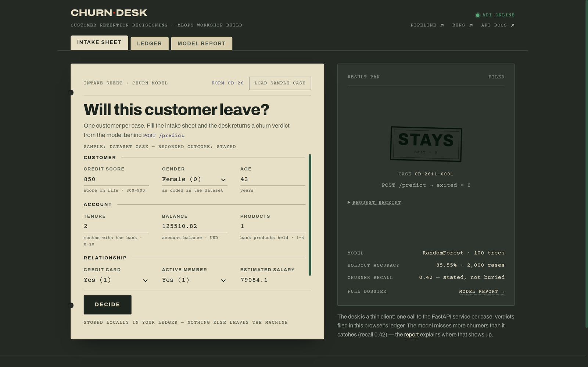
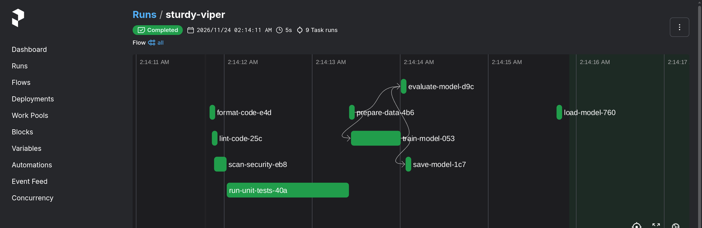
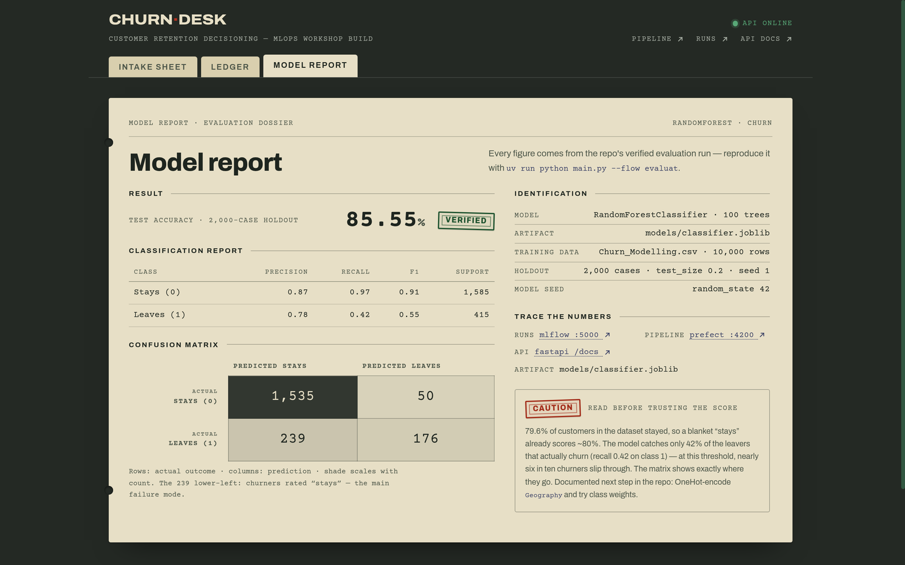
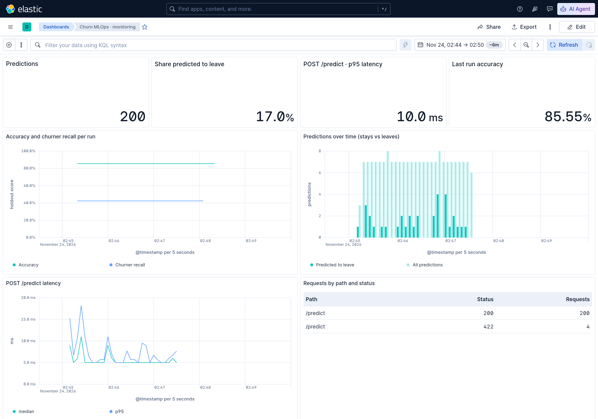

<h1 align="center">Customer Churn MLOps</h1>

<p align="center">
  A bank-churn notebook turned into a <b>tested, scheduled pipeline</b>: four code gates run before anything trains,<br>
  three Prefect flows retrain and re-score on a daily schedule, every run lands in MLflow, a FastAPI service and a small desk serve the model,<br>
  and an optional ELK layer shows traffic, predictions and model quality in Kibana.
</p>

<p align="center">
  <a href="https://github.com/adriansalvadorekomo/customer-churn-mlops/actions/workflows/ci.yml"></a>
  
  
  
  
  
  
  
  
</p>

<p align="center">
  
</p>

---

## What it is for

The starting point was a one-off Jupyter notebook: no tests, no schedule, retrained by hand. This repository keeps the model and makes everything around it repeatable:

- **Nothing trains on unchecked code.** `ruff format`, `ruff check`, `bandit` and `pytest` run as blocking Prefect tasks right after the dependencies install, and the same four checks run in GitHub Actions on every push and pull request.
- **Security scanning is strict.** Bandit fails on any severity; the only two rules skipped (`subprocess` with fixed argument lists, never `shell=True`) are listed and justified in `pyproject.toml`, and processes are started by absolute path.
- **Retraining runs itself.** Three deployments (`all`, `train`, `evaluat`) run once a day at 02:00, 04:00 and 06:00 UTC, so heavy jobs never overlap.
- **Every training run is traceable.** Parameters, accuracy and the fitted model go to MLflow; a tracking outage is logged as a warning and never fails the pipeline.
- **The model is usable without code.** `POST /predict` serves it; the Churn Desk calls it one customer at a time and shows the model report next to the verdict.
- **What it does in use is visible.** Every request, prediction and run prints one JSON event; in the `monitoring` profile Filebeat, Logstash and Elasticsearch carry them to a Kibana dashboard.

## How it works

<p align="center">
  <a href="docs/diagrams/c4/c4-container-light.svg">
    <picture>
      <source media="(prefers-color-scheme: dark)" srcset="docs/diagrams/c4/c4-container-dark.png">
      
    </picture>
  </a>
  <br><sub>C4 Level 2. Click for the SVG · <a href="docs/diagrams/c4/c4-context-light.png">Level 1: system context</a> · <a href="docs/diagrams/c4/c4-component-light.png">Level 3: pipeline components</a></sub>
</p>

- **One image, two roles.** `Dockerfile.backend` builds once; the `backend` service runs uvicorn, the `worker` service runs `deploiement_prefect.py --container`. Inside the image the flows skip `fetch-source-code` and `install-dependencies`, because the image already ships both.
- **Pure logic, then orchestration.** `src/model_pipeline.py` has seven plain functions and no Prefect import; `src/tasks.py` wraps each as a task (retries on prepare and train); `src/flows.py` chains them. The same code runs from `main.py`, a Prefect deployment or a test.
- **The model crosses containers as a file.** The worker writes `models/classifier.joblib` to a host volume; the API loads it at start, so `docker compose restart backend` serves a retrained model.

### Inside a run

<p align="center">
  
  <br><sub>A real run of <code>all</code>: the four gates in parallel, then prepare → train → evaluate / save → load (9 tasks, 5 s).</sub>
</p>

| Flow | Jobs | Schedule (UTC) |
|---|---|---|
| `all` | fetch → install → gates → prepare → train → evaluate → save → load | 02:00 |
| `train` | prepare → train → save | 04:00 |
| `evaluat` | load → evaluate | 06:00 |

## Results

Measured on the 2,000-customer holdout (80/20 split, seed 1; RandomForest, 100 trees, `random_state` 42). A fresh run reproduces these numbers exactly.

| | |
|---|---|
| Accuracy | **85.55%** |
| Baseline: always predict "stays" | 79.25% (1,585 of 2,000) |
| Churners caught (recall, class 1) | **0.42** (176 of 415), precision 0.78 |
| Tests | 15 (6 pipeline, 4 API, 3 monitoring events, 2 fetch task), run as a gate inside every full flow and in CI |
| Bandit | 0 findings at any severity over the app code (10 files, about 1,450 lines) |

<p align="center">
  
</p>

**Read the accuracy with the recall.** About one customer in five leaves (20.4% of the dataset), so a model that always says "stays" already scores about 80%. This one beats it by about 6 points but still misses 239 of 415 churners: it runs with default settings (no class weights, the default 0.5 threshold) and drops `Geography`, as the notebook did. The weak number is stated, not hidden; the fix is listed below.

## Monitoring (ELK)

<p align="center">
  
  <br><sub>A real session: 200 rows of the dataset sent to <code>POST /predict</code>, 4 invalid requests, and 9 flow runs (5 train, 4 evaluate). Every run scores the same 85.55% and 0.42 recall because the split and the forest are seeded: the chart is there to catch a retrain that drifts.</sub>
</p>

`src/observability.py` prints one JSON line per event, with nothing but the standard library: the app runs the same with or without Elastic. `docker compose --profile monitoring up -d` adds the stack that reads those lines:

| Event | Emitted by | Fields |
|---|---|---|
| `http_request` | API middleware, every call | `method`, `path`, `status`, `duration_ms` |
| `prediction` | `POST /predict` | `exited` (0 stays, 1 leaves) |
| `training_run` | `all` and `train` flows | `flow`, `accuracy`, `recall_churn` (all), `n_estimators`, `duration_s` |
| `evaluation_run` | `evaluat` flow | `accuracy`, `recall_churn`, `duration_s` |

- **Filebeat** reads the Docker logs of the two containers labelled `churn_logs: "true"` (backend and worker) and nothing else on the host.
- **Logstash** ([`churn.conf`](monitoring/logstash/pipeline/churn.conf)) parses the JSON lines into `churn-events-*` with the event's own timestamp; uvicorn and Prefect text goes to `churn-logs-*`.
- **`monitoring-setup`** ([`setup.py`](monitoring/kibana/setup.py)) runs once: an index template (so `accuracy` is always a number), the data view, and the dashboard **Churn MLOps · monitoring** at http://localhost:5601.

The dashboard answers three questions: is the API used and fast (requests, p95 latency, status codes), what does the model predict in use (volume and share predicted to leave), and does a retrain keep its quality (accuracy and churner recall per run). It is local only: Elastic security is off and every monitoring port is bound to 127.0.0.1.

## Engineering decisions

| Decision | Why | Cost |
|---|---|---|
| Gates are Prefect tasks inside the flow, and the same commands in CI | A scheduled run on a server is checked the same way as a push | The full flow takes longer than training alone |
| Bandit at every severity, two reviewed skips in `pyproject.toml` | `-ll` hid a real finding (git started by bare name, B607); one config serves the gate and CI | A new low-severity pattern fails the build until fixed or reviewed |
| Logic in `model_pipeline.py`, orchestration in `tasks.py` / `flows.py` | Tests and the CLI run the logic without a Prefect server | Two layers to keep in sync |
| MLflow outage = warning | Tracking must not take the pipeline down | A run can finish without a trace; the log says so |
| Monitoring through stdout, not an Elastic client in the app | No dependency or failure mode added to the API; Docker already keeps stdout | Events reach Kibana only in the `monitoring` profile |
| `prefect.serve` in-process, no work pool | One container schedules and executes; nothing else to operate | No horizontal scaling of runs |
| Notebook kept faithful where it matters | Accuracy stays comparable with the original (~85.5%) | `Geography` stays dropped for now |

Two notebook bugs were **not** reproduced: a `StandardScaler` fitted separately on train and test (leakage, and never used), and `df.isnull` without parentheses. The full mapping from notebook cells to functions is in [docs/howToDoModular.md](docs/howToDoModular.md) (French).

## Quick start

Needs Python 3.12 and [uv](https://docs.astral.sh/uv/); Docker for the full stack.

```bash
git clone https://github.com/adriansalvadorekomo/customer-churn-mlops.git
cd customer-churn-mlops
uv sync

uv run python main.py                 # full run: install → gates → train → evaluate → save
uv run python main.py --flow all      # the same, through Prefect (no server needed)
uv run pytest -q                      # 15 tests
uv run bandit -c pyproject.toml -r .  # security gate, same command as CI
uv run uvicorn src.app:app --reload   # the API, Swagger at /docs
```

**The whole stack:**

```bash
docker compose up --build             # or: docker compose pull backend frontend && docker compose up -d
docker compose --profile monitoring up -d   # the same, plus Elasticsearch, Logstash, Filebeat and Kibana
```

| Service | URL | Role |
|---|---|---|
| `frontend` | http://localhost:4321 | Churn Desk: intake sheet, ledger, model report |
| `backend` | http://localhost:8000 | `POST /predict`, `GET /health`, `/docs` |
| `prefect-server` | http://localhost:4200 | Deployments, schedules, run history |
| `worker` | (none) | Serves the three deployments and executes runs |
| `mlflow` | http://localhost:5000 | One run per training |
| `kibana` (monitoring) | http://127.0.0.1:5601 | Dashboard **Churn MLOps · monitoring** |
| `elasticsearch`, `logstash`, `filebeat` (monitoring) | 127.0.0.1:9200 | Store, parse and ship the events |

Then trigger `all/daily-all` in Prefect, watch it appear in MLflow, and `docker compose restart backend` to serve the new model. Check the schedules without a server: `python deploiement_prefect.py --dry-run`.

Without Docker, the desk runs with `cd frontend && npm install && npm run dev` (it calls the API on :8000; bake another URL with `PUBLIC_API_URL=… npm run build`). Prebuilt images are published as `twelvy1400/churn-mlops-backend` and `twelvy1400/churn-mlops-frontend` (`:latest` and `:<short-sha>`).

## Repository map

| Path | What lives there |
|---|---|
| [`src/model_pipeline.py`](src/model_pipeline.py) | Seven pure functions: install, prepare, train, evaluate, save, load, predict |
| [`src/tasks.py`](src/tasks.py) | One Prefect task per job, plus the four code gates |
| [`src/flows.py`](src/flows.py) | The `all`, `train` and `evaluat` flows |
| [`src/tracking.py`](src/tracking.py) | MLflow logging (params, accuracy, model) |
| [`src/app.py`](src/app.py) | FastAPI: `GET /health`, `POST /predict`, one `http_request` event per call |
| [`src/observability.py`](src/observability.py) | JSON events on stdout (stdlib only) |
| [`monitoring/`](monitoring/) | Filebeat, Logstash pipeline, Kibana setup (index template, data view, dashboard) |
| [`deploiement_prefect.py`](deploiement_prefect.py) | The three cron deployments (`--container`, `--dry-run`) |
| [`frontend/`](frontend/) | Churn Desk: Astro + Tailwind, built and served by nginx |
| [`tests/`](tests/) | 6 pipeline, 4 API, 3 monitoring-event and 2 fetch-task tests |
| [`.github/workflows/ci.yml`](.github/workflows/ci.yml) | The four gates on every push and pull request; Bandit report as an artifact |
| [`notebooks/`](notebooks/) | The original notebook and `Churn_Modelling.csv` |
| [`docs/diagrams/c4/`](docs/diagrams/c4/) | C4 diagrams and their generator (`python docs/diagrams/c4/build_c4.py`) |

## Limitations and next steps

- **Class imbalance is not handled yet.** Next: one-hot encode `Geography`, try `class_weight="balanced"`, compare the runs in MLflow.
- **One process schedules and executes.** Enough for one daily model; a work pool would be needed to run flows in parallel.
- **The API serves the model it loaded at start.** A retrained model needs `docker compose restart backend`.
- **Monitoring is for one machine.** Elastic security is off and nothing alerts yet; next: a Kibana rule on the churner recall of the last run.

---

<p align="center">
  <sub><a href="https://github.com/adriansalvadorekomo"><b>Adrián Salvador Ekomo</b></a> · <a href="https://adriansalvadorekomodev.vercel.app">portfolio</a> · <a href="https://adriansalvadorekomodev.vercel.app/blog/accuracy-recall-put-the-weak-number-in-the-readme">Write-up: 85.5% accuracy, 0.42 recall: put the weak number in the README</a></sub>
</p>
