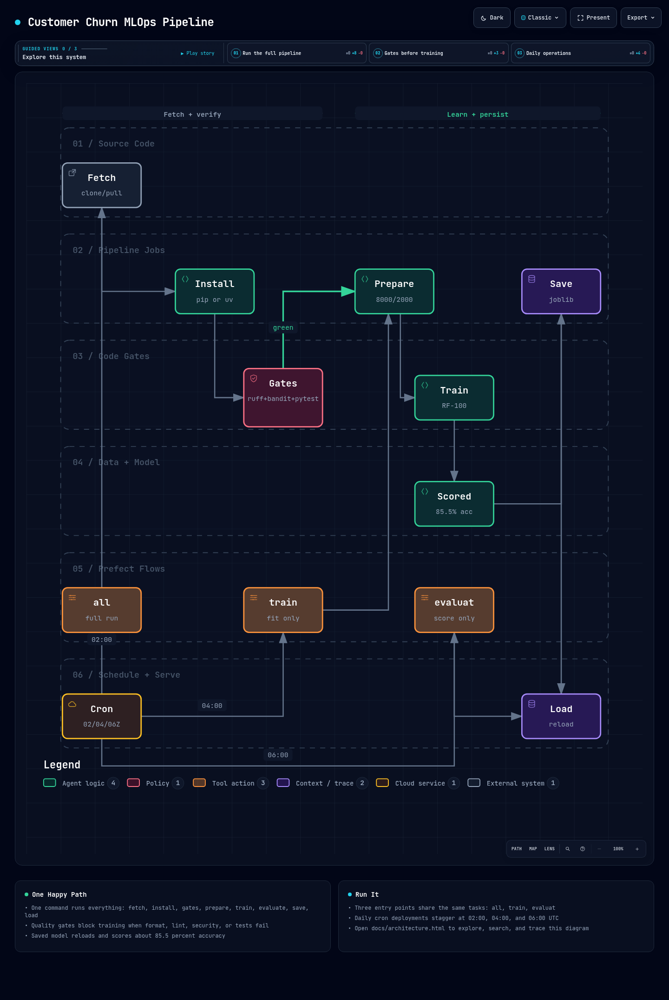

# Customer Churn MLOps


Bank customer churn prediction, from an exploratory Jupyter notebook to a
**modular, tested, and daily-scheduled MLOps pipeline** orchestrated with Prefect.

> A RandomForest classifier predicts whether a bank customer will leave
> (`Exited`), reaching **85.5% accuracy** on a 2,000-customer holdout set.

[](docs/architecture.html)

*Above: the full pipeline at a glance. For the interactive version (search,
tracing, guided views), open [`docs/architecture.html`](docs/architecture.html)
locally in your browser — GitHub previews the image, the HTML runs locally.*

---

## 1. Quickstart

### With `uv` (recommended)

```bash
uv sync
uv run python main.py                 # full run: install → gates → train → evaluate → save
```

### With `pip` (classic venv)

```bash
python -m venv .venv && source .venv/bin/activate
pip install -r requirements.txt       # same pins as pyproject.toml
python main.py --skip-install
```

### Useful variants

```bash
uv run python main.py --flow train    # prepare + train, via Prefect (no server needed)
uv run python main.py --flow evaluat  # load saved model + evaluate, via Prefect
uv run python main.py --flow all      # everything, via Prefect
uv run python main.py --no-train      # reuse models/classifier.joblib, skip training
uv run pytest -q                      # 6 unit tests
```

---

## 2. How it works — 6 jobs, 3 flows

Pure logic lives in `src/model_pipeline.py` (importable without Prefect);
`src/tasks.py` wraps each job as a Prefect `@task`, and `src/flows.py`
chains them into flows.

| # | Job (task) | What it does |
|---|------------|--------------|
| 0 | `fetch-source-code` | `git clone` if missing, `git pull --ff-only` if an `origin` remote exists, graceful skip otherwise |
| 1 | `install-dependencies` | `pip install -r requirements.txt` (auto-fallback to `uv pip` inside uv venvs) |
| 2 | `prepare-data` | Label-encodes `Gender`, drops ID/text cols, 80/20 split (seed 1) |
| 3 | `train-model` | `RandomForestClassifier(n_estimators=100, random_state=42)` |
| 4 | `evaluate-model` | Accuracy + classification report + confusion matrix (returned as dict) |
| 5 | `save-model` | `joblib.dump` → `models/classifier.joblib` |
| 6 | `load-model` | `joblib.load` + demo prediction on a sample customer |

Code gates run right after the install step, before any training:

| Gate (task) | Tool | Fails the pipeline when… |
|-------------|------|--------------------------|
| `format-code` | `ruff format` | style drift (auto-fixed, then re-checked) |
| `lint-code` | `ruff check` | any lint violation |
| `scan-security` | `bandit -r src -ll` | medium+ severity issue |
| `run-unit-tests` | `pytest` | any test in `tests/` fails |

### The 3 flows

| Flow | Jobs | Use it to… |
|------|------|------------|
| `all` | fetch → install → gates → prepare → train → evaluate → save → load | nightly full run (scheduled 02:00 UTC) |
| `train` | prepare → train → save | retrain on fresh data (scheduled 04:00 UTC) |
| `evaluat` | load → evaluate | score the saved model (scheduled 06:00 UTC) |

---

## 3. Daily automation (Prefect)

`deploiement_prefect.py` builds one cron deployment per flow — **one run per
day, staggered so heavy jobs never overlap**:

| Deployment | Cron (UTC) | Flow |
|------------|-----------|------|
| `all/daily-all` | `0 2 * * *` | full pipeline |
| `train/daily-train` | `0 4 * * *` | prepare + train |
| `evaluat/daily-evaluat` | `0 6 * * *` | load + evaluate |

Test with 3 terminals:

```bash
# T1 — API + UI
prefect server start                      # http://127.0.0.1:4200
# T2 — build + serve the deployments (scheduler + runner, no worker needed)
python deploiement_prefect.py
# T3 — trigger immediately (or click Run in the UI)
prefect deployment run "all/daily-all"
```

No server handy? Validate the schedule offline:

```bash
python deploiement_prefect.py --dry-run   # builds deployments, prints plan, exits
python deploiement_prefect.py --flows train --dry-run
```

---

## 4. Project structure

```text
customer-churn-mlops/
├── src/
│   ├── model_pipeline.py   # 6 pure functions (no Prefect import)
│   ├── tasks.py            # 1 Prefect @task per job + 4 code-gate tasks
│   └── flows.py            # all / train / evaluat
├── tests/
│   └── test_pipeline.py    # 6 example unit tests
├── notebooks/
│   ├── customer_churn.ipynb
│   └── data/Churn_Modelling.csv
├── models/
│   └── classifier.joblib   # trained artifact (85.5% accuracy)
├── docs/
│   ├── architecture.html   # interactive pipeline diagram (open locally)
│   ├── assets/pipeline-preview.png
│   └── howToDoModular.md   # Feynman-style guide: notebook → modules
├── main.py                 # CLI: direct run or --flow {all,train,evaluat}
├── deploiement_prefect.py  # daily cron deployments
├── requirements.txt        # pip (mirrors pyproject.toml for uv users)
└── pyproject.toml
```

---

## 5. Results

```
Accuracy score: 85.55
              precision    recall  f1-score   support
           0       0.87      0.97      0.91      1585
           1       0.78      0.42      0.55       415
Confusion matrix:
[[1535   50]
 [ 239  176]]
```

> Class imbalance (79.6% stayed / 20.4% left) caps recall on churners at 0.42.
> Documented next step: OneHot-encode `Geography` (currently dropped, as in the
> notebook) and try class weights.

---

## 6. Docs

- [`docs/architecture.html`](docs/architecture.html) — interactive pipeline
  diagram: guided views, tracing, light/dark, PNG/SVG export.
- [`docs/howToDoModular.md`](docs/howToDoModular.md) — step-by-step beginner
  guide (in French): how this notebook became 6 reusable functions.

## 7. Roadmap

- [ ] OneHot-encode `Geography` + `class_weight="balanced"`, compare runs
- [ ] Experiment tracking (MLflow) instead of printed metrics
- [ ] `Dockerfile` + Prefect worker image for the daily deployments
- [ ] GitHub Actions CI: ruff + bandit + pytest on every push
